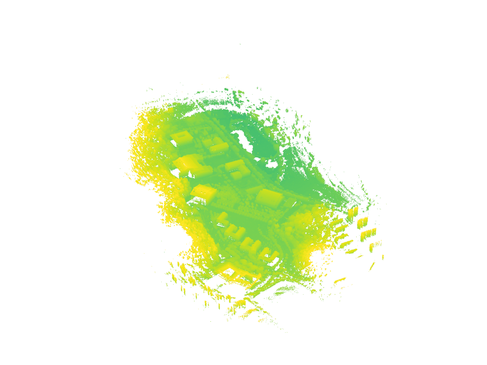
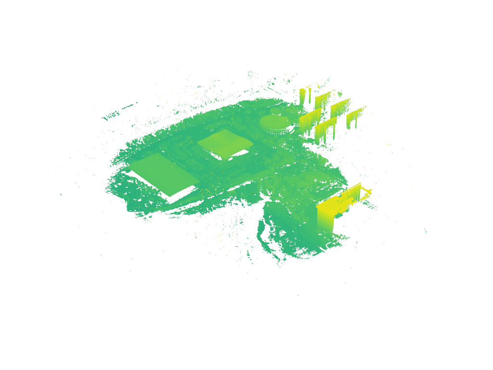
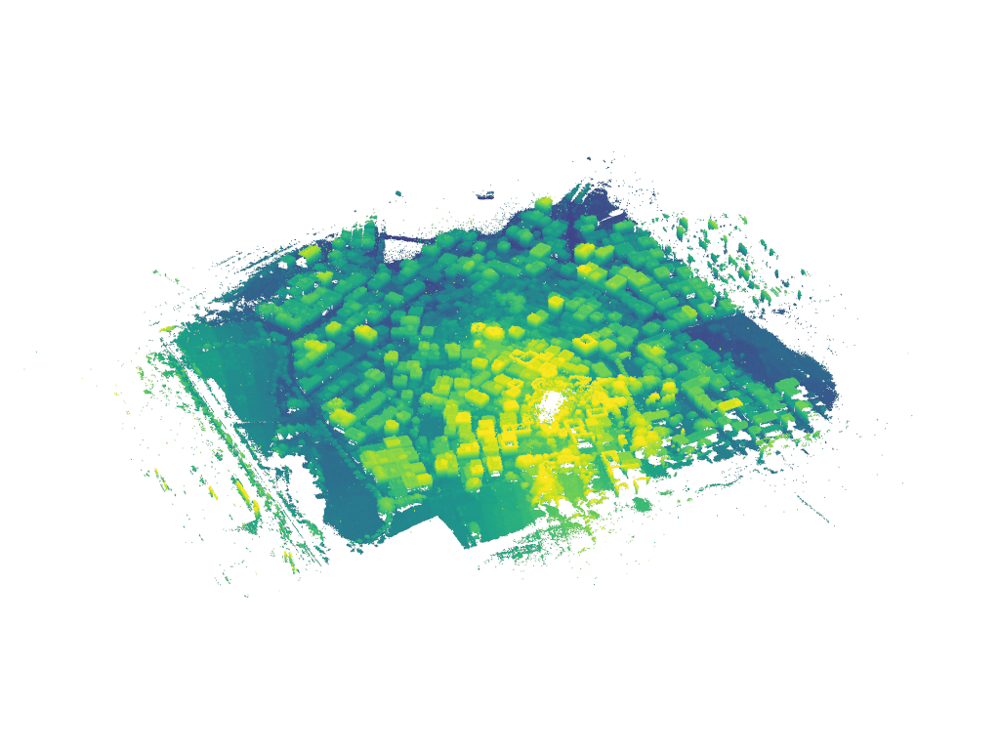
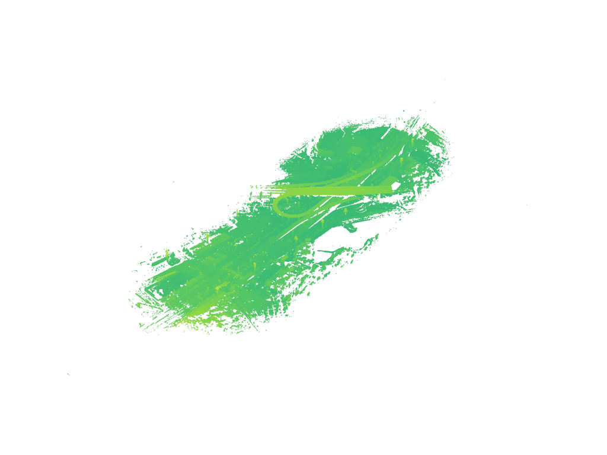
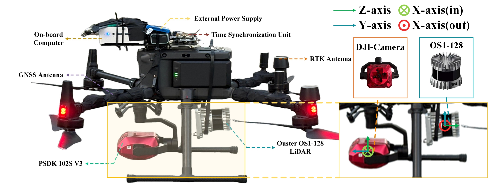
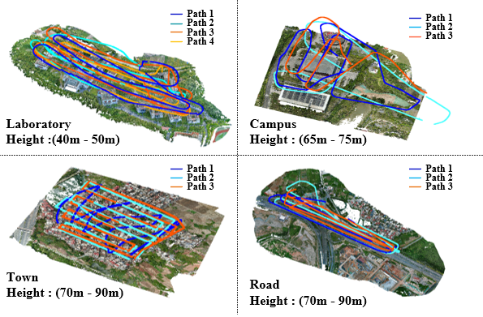
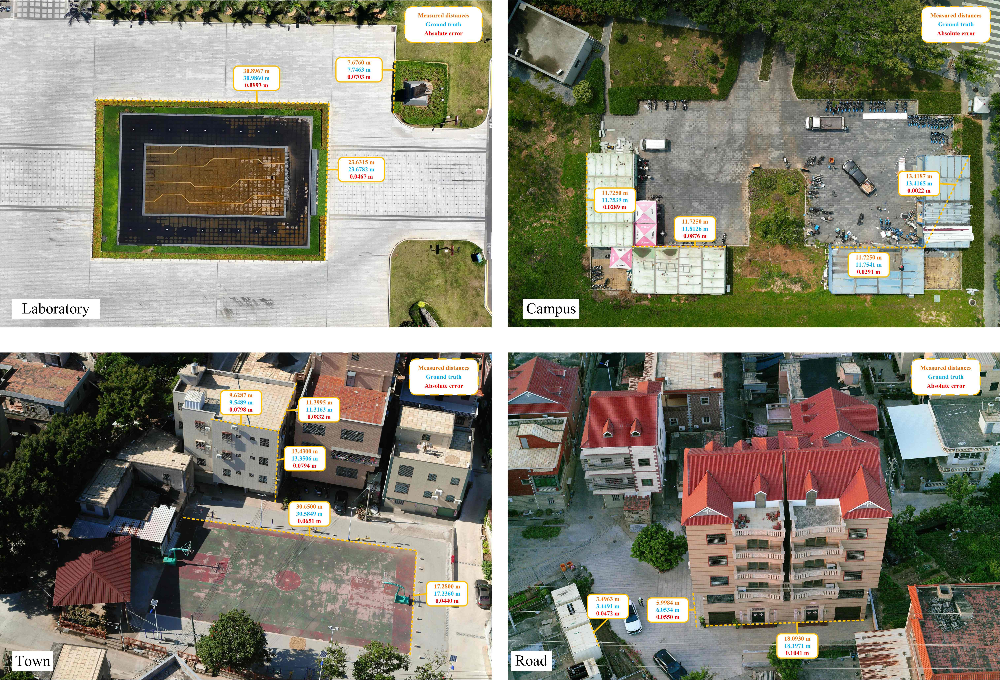

# SOAR: Regression-based LiDAR Relocalization for UAVs

This repository provides a demo release of the UAVLoc dataset introduced in our paper. The full UAVLoc dataset and the official implementation of SOAR will be released soon.

---

## 📌 Overview

<table align="center">
<tr>
<td align="center">
<br>
Laboratory
</td>

<td align="center">
<br>
Campus
</td>
</tr>
</table>

<table align="center">
<tr>
<td align="center">
<br>
Town
</td>

<td align="center">
<br>
Road
</td>
</tr>
</table>

We present **UAVLoc**, a LiDAR relocalization dataset for UAVs, designed to reflect real-world aerial perception challenges, including:

- Irregular and non-repetitive flight trajectories  
- Significant yaw and altitude variations  
- Partial spatial overlap between training and testing flights  

Unlike existing UAV localization datasets, UAVLoc focuses on **distribution-shifted aerial relocalization under realistic UAV operating conditions**.

---

## 📂 Dataset (Demo Version)

The released dataset is a **small-scale subset** of UAVLoc for reproducibility verification.

### Statistics
- Scenes: 4 
- Frames/Scene: 100 (subset of full dataset)
- Trajectories: multiple irregular UAV flights
- Sensor modality: LiDAR point clouds -- point_clouds/
- Ground truth: 6-DoF poses -- LiDAR-pose.txt

---


## 📁 Dataset Structure

The dataset follows the structure below:

```bash
UAVLoc_demo/
└── Lab_01/
└── Lab_02/
    ├── point_clouds/   # LiDAR scans (.ply)
    │   ├── frame_01.ply      
    │   ├── frame_02.ply        
    │   ├── frame_03.ply   # synchronized timestamps
    │   └── ...
    └── LiDAR-pose.txt  # 6-DoF ground truth poses
└── Lab_03/
└── ...
```

---
## 🚁 Sensors Setup

<table align="center">
<tr>
<td align="center">
<br>
Data Collection Platform
</td>
</tr>
</table>

As shown in above figure, all sensors are mounted on a DJI M300 RTK industrial UAV. The primary perception sensors include a PSDK 102 V3 camera and an Ouster OS1-128 LiDAR, which are synchronized using a hardware time-synchronization module. The on-board computer is used to control the UAV and collect the raw LiDAR point cloud data.

Our dataset primarily comprises two sensors: (1) an Ouster OS1-128, a 128-beam spinning LiDAR used for point cloud acquisition, with its field of view (FOV), resolution, and frame rate (FPS) configured to [-22.5°, 22.5°], 20×1024, and 20 Hz, respectively. (2) A DJI camera directly records the UAV’s pose information and refines it through image-based optimization, yielding highly accurate UAV pose. 

---

## 🚁 Irregular Trajectories


UAVLoc contains non-repetitive UAV flight paths, leading to partial spatial overlap between trajectories. 

<table align="center">
<tr>
<td align="center">
<br>
Flight trajectories in four scenes.
</td>
</tr>
</table>

These irregular trajectories significantly increase the difficulty of map-free LiDAR relocalization and better reflect real-world UAV deployment conditions.

---

## 🧠 Ground Truth

In UAVLoc, LiDAR point clouds are used for relocalization, and ground truth poses are generated through a multi-stage pipeline:

 - Camera-based pose estimation using DJI Terra
 - LiDAR–camera temporal and spatial alignment
 - ICP refinement between LiDAR frames and globally optimized map

The camera data are processed with DJI Terra to obtain high-precision UAV poses, which are then aligned with the LiDAR frames through camera calibration and time synchronization. Moreover, due to inevitable UAV vibrations during flight, following UAVScenes and KITTI, we further refine the LiDAR poses by performing ICP between each LiDAR frame and the high-precision point cloud map generated by DJI Terra, yielding highly accurate LiDAR poses. This process enables us to derive an accurate 6-DoF ground-truth pose for every LiDAR scan.

## 📊 Ground Truth Validation

<table align="center">
<tr>
<td align="center">
<br>
Verification of our GT against actual measurement landmarks.
</td>
</tr>
</table>

To validate the accuracy of the ground truth, we utilized a tape measure and a single-point laser rangefinder to measure the distance between some landmarks in each scene. we conducted quantitative evaluations across multiple manually selected landmarks in four scenes. We conducted quantitative evaluations across four scenes by comparing measured landmark distances with those derived from point cloud maps reconstructed using our ground truth. For the line segments we measured, the average error relative to the ground truth is 6.08cm, which demonstrates the accuracy of our GT. This level of accuracy is comparable to that reported in UAVScenes, which adopts a similar ground-truth generation pipeline. Compared to standalone LiDAR odometry or RTK-based localization, this pipeline leverages globally optimized photogrammetry maps, resulting in significantly higher consistency and accuracy.

---

⚠️ License & Anonymity

This work adheres to strict ethical and legal standards for geospatial data. UAVLoc was collected under formal approval; we will release it with (1) Licensing: The dataset is released under CC BY-NC-SA 4.0, while the source code follows the Apache 2.0 License. (2) Compliance: Data collection was conducted in compliance with local aviation and surveying regulations. All UAV operations were restricted to authorized altitudes and public areas. (3) Privacy: We have implemented a rigorous sanitization pipeline to redact sensitive information, such as random offset of coordinates and to reduce the risk of identifying sensitive infrastructure. (4) Governance: For any compliance inquiries or takedown requests, please contact the corresponding author. We maintain a permanent maintenance policy to respond to such requests promptly.

---
